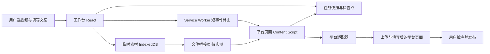

# 视频上传填表助手：第一版设计方案

日期：2026-11-07

状态：设计草案；用户已确定产品边界，本文中的技术细节待设计确认和可行性验证。

独立审阅：2026-11-07 已完成 builder check，无影响编写实施计划的重要未决问题；不代表技术路径已实测。

项目目录：`/Users/ajk-corly/vscode/video-upload-plugin`

## 1. 目标与已确认需求

做一个轻量、本机使用的浏览器插件，减少同一条视频在多个平台重复上传、复制文案的操作。第一版的完成点是“视频上传并填写完成，等待用户检查”，不是作品发布成功。

用户已明确：

- 一次选择一个视频，分发到多个平台。
- 目标平台包括小红书、抖音、B站、视频号、快手。
- 由用户检查，由用户点击发布。
- 第一版先简单地跑通流程，不做自动发布；后续再考虑。
- 当前任务是把方案写入本目录，尚未要求开始编写插件。

前序沟通提出并沿用的默认方案：纯 Chrome / Edge 插件、独立工作台标签页、共用文案与平台覆盖值、每个平台一张自定义封面、顺序处理目标平台。技术选型和以下具体默认值是设计建议，不冒充用户逐项确认的要求。

## 2. 范围与非目标

### 第一版提供

1. 在插件工作台选择本地视频和可选的共用封面。
2. 输入共用标题、简介、标签，勾选目标平台。
3. 按平台覆盖文案和封面，不自动改写或截断用户内容。
4. 复用当前浏览器 Profile 已登录的账号，打开独立的平台发布标签页。
5. 上传视频，设置支持的字段和封面，读取页面结果。
6. 展示各平台进度、待处理原因及“打开页面”入口。
7. 保留平台编辑页面，交给用户检查、补充和发布。

### 第一版不提供

- 自动发布、后台代提交，以及调用发布接口。小红书的定时发布时间可以由插件填写并回读（仅限未来 7 天内，也可在开始前清理），但最终仍由用户点击发布。
- 主动点击“存草稿”“暂存离开”等按钮；平台自行保存的行为不属于插件的草稿保证。
- 多视频批处理、多账号隔离、自动切换账号。
- 视频剪辑、压缩、转码、封面生成、AI 文案。
- 多封面、横竖双封面专用流程、视频分P、商品链接、合集等高级字段的自动填写。
- 原创、转载、AI 生成等内容声明的自动推断或默认勾选。
- 远程视频 URL、目录监控、本地服务、平台开放 API 授权、中转服务。
- 关闭浏览器后继续工作，或保证平台视频断点续传。

**不可妥协的行为边界：** 插件不得触发作品发布；不得把文件已送入控件当成上传完成；不得覆盖用户后来在平台页面上的修改；不得将仍需人工处理的任务标为填写成功。

## 3. 方案比较与选择

| 方案 | 运行方式 | 优点 | 代价与结论 |
| --- | --- | --- | --- |
| 纯浏览器插件 | 扩展页面管理任务，页面脚本操作各平台后台 | 复用登录态，无独立运行环境，方便人工接手 | 文件交接和平台页面适配需要验证；本方案采用 |
| 插件 + 本地服务 | 插件操作网页，本地服务管理文件和任务 | 便于目录监控、转码及外部程序调用 | 需要安装、启动和维护服务，超出当前轻量目标 |
| 继续封装现有 Python / Electron 工具 | 包装既有上传器 | 可参考成熟的页面适配经验 | 保留额外运行环境，仍需修改上传后自动发布的流程 |

前三轮讨论已比较纯插件与本地服务，随后用户要求沿插件方案编写设计。本阶段不重新选择路线。公开项目只作为页面流程与结果核验的参考，不把其“支持平台”列表视为本插件已经验证的能力。

## 4. 技术栈

| 层次 | 选择 | 职责 |
| --- | --- | --- |
| 浏览器扩展 | Manifest V3 | 扩展入口、权限、后台事件、脚本注入 |
| 语言 | TypeScript | 共用任务、消息和平台适配器类型 |
| 工作台 | React + 简单 CSS | 素材、文案、平台选择、任务状态 |
| 构建 | Vite | 构建工作台、Service Worker、Content Script 和资源桥接页 |
| 页面自动操作 | Content Scripts + `chrome.scripting` | 定位控件、填表、上传交接、结果读取 |
| 元数据 | `chrome.storage.local` | 任务快照、平台配置、检查点 |
| 临时素材 | 扩展源下的 IndexedDB | 保存同一批任务共享的视频和封面 Blob |
| 自动验证 | TypeScript 检查、Vitest；浏览器扩展集成验证 | 测试状态、字段保护、消息边界和不提交约束 |

产品不依赖 Python、Electron、Playwright 或服务器。开发时可以用浏览器自动化工具测试扩展，这不构成用户的运行依赖。npm 管理依赖，首版不引入大型组件库、全局状态框架或远程脚本加载机制。

先在用户的 macOS Chrome 环境验证，之后验证 Edge。浏览器最低版本根据首个可行性里程碑的实测确定并写入 manifest；不先承诺所有 Chromium 历史版本。第一版通过“加载已解压的扩展程序”交付，商店发布另行安排。

## 5. 用户流程

### 准备

- 点扩展图标，打开或聚焦唯一的工作台标签页。
- 选择一个视频，展示文件名、大小；封面可不选。
- 填写共用标题、简介、标签，勾选目标平台。
- 每个平台默认继承共用内容，也可独立覆盖；字段要区分“继承”和“明确留空”。
- 根据已验证的平台限制预检，提示过长标题、过多标签或不支持的文件。超限由用户修改，不静默裁剪。

### 执行

点击“开始上传并填写”后冻结本次平台配置快照，按小红书、抖音、B站、视频号、快手的顺序处理勾选项。一次只自动处理一个平台，减少同时持有大视频和上传带宽的压力。

每个平台执行：打开新发布页 → 检查登录和页面是否为空 → 交接视频 → 等待页面完成上传/必要处理 → 填写字段和封面 → 回读验证 → 停止页面操作并交接。

首次实现按串行推进。一个平台需要人工介入或超时后，停止它的自动写入并标记原因，再继续下一个平台。用户可随时查看已打开的平台页面；手动接管某个平台后插件不再继续改动它。

### 交接

- 自动处理的字段全部得到确认，显示“待你检查”。它只表示填写完成，不等于平台全部必填项齐全，更不等于可直接发布。
- 尚有封面裁剪、必选分类、声明或无法确认的内容时，显示“需你处理”，逐项列出原因。
- 点击“打开页面”进入原标签页，用户补充、修改并手动发布。
- 插件交接后不再周期性写表单，也不轮询用户是否已经发布；任务可以由用户手动标记结束。

平台页面需要保持打开。工作台显示运行中勿关闭的提示；已经交接的平台标签页不会被插件自动关闭或刷新。

## 6. 架构与职责

- **工作台：** 本批任务的串行调度器；持有用户操作入口，管理素材和平台快照。
- **Service Worker：** 创建/绑定标签页、权限检查、转发小消息、登记页面事件；不承担整个上传的长等待，不靠内存变量保存唯一任务状态。
- **Content Script：** 执行当前页面上的有限步骤，检测导航和用户接管，报告已观察到的结果。
- **文件桥接：** 单独封装扩展源素材到目标页面的交接，不把大视频放入普通 JSON 消息。
- **平台适配器：** 每个平台一个模块，负责页面识别、字段定位、上传、封面以及结果读取；不实现发布动作。

任务消息绑定 `batchId`、`taskId`、`attemptId`、`tabId`、页面文档标识和步骤编号。旧页面、旧重试或其他标签页的回调不能推进当前任务或覆盖状态。

## 7. 文件交接：先验证，再扩大开发

这是纯插件方案的首要技术风险，不能把 Playwright 的 `set_input_files(本地路径)` 直接翻译成扩展脚本。普通文件选择器提供 File，页面无法靠文件路径读取磁盘；Chrome 扩展常用消息通道使用 JSON 序列化，不能默认直接传 File / Blob。参见 [Chrome 消息文档](https://developer.chrome.com/docs/extensions/develop/concepts/messaging) 和 [文件输入说明](https://developer.mozilla.org/en-US/docs/Web/API/HTMLInputElement/files)。

### 首选验证路径

1. 用户在工作台选择视频，扩展把 Blob 临时写入扩展源 IndexedDB。整批只保存一份视频，各平台封面按素材 ID 引用。
2. 在已授权且与当前任务绑定的平台标签页中加载扩展自带的文件桥接 iframe。`web_accessible_resources` 只开放该桥接资源及必要静态依赖，匹配指定平台域名。
3. 桥接页通过扩展内部消息获取一次性素材授权，核对发送者的标签页、frame、父页面、当前任务与素材范围；不从 URL 参数直接接受任意素材 ID 并返回内容。
4. 桥接页从扩展 IndexedDB 读取素材，通过经校验的 `postMessage` / MessageChannel 向当前页面交接 Blob/File；不用通配 `targetOrigin`，不广播素材，不开放任意文件查询。
5. 页面适配器构造 FileList，尝试赋给目标 `input[type=file]` 并发送控件所需事件；必要的 MAIN world 代码限制为平台控件交互，不暴露扩展管理接口。
6. 以真实平台出现文件信息、上传进度以及最终预览为判据，不能以赋值或事件派发成功为判据。

Chrome 文档说明嵌入网页的 `chrome-extension://` 页面具有存储分区例外，Content Script 直接访问的 IndexedDB 则属于宿主网页；所以这里明确使用扩展源桥接页。[存储文档](https://developer.chrome.com/docs/extensions/develop/concepts/storage-and-cookies)

### 尚待验证的部分

- 平台 CSP、iframe 限制、页面导航以及 Content Script / MAIN world 边界是否影响桥接。
- 页面上传控件是否接受脚本创建的 FileList 和非用户原生事件。
- 大文件复制、磁盘配额、内存占用及跨五个平台的资源释放。
- 必要控件是否位于跨域 iframe 或 closed Shadow DOM 内；只适配实测可访问路径，无法处理时交给用户。

本节是拟实现方案，不是已运行证明。第一阶段必须先在小红书和另一个平台验证同一素材可从工作台交接，随后在其余三个站点验证文件入口，再扩大完整填表开发。

如果桥接不可用，可以评估有确认和背压的分块传输，但不能退化为把整个大视频编码后经消息通道反复搬运。不默默增加 `debugger` 权限、本地服务或逐个平台重新选文件来冒充既定目标；涉及这些范围变化时，写明实测结果再调整方案。

初期用约 20 MiB、100 MiB、500 MiB 的有效视频逐级验证；500 MiB 是设计者建议的验收样本，不是用户视频上限或平台上限。发布前根据实测写明插件自己的支持范围，未验证的大文件不标为支持。

## 8. 平台适配契约

每个平台实现以下步骤，返回结构化结果：

| 能力 | 输出与约束 |
| --- | --- |
| 识别页面与登录 | 发布页是否匹配、是否已登录、可观察账号；识别不到时不猜测 |
| 读取能力 | 支持字段、已验证的长度与文件限制、需人工填写的字段 |
| 检查编辑状态 | 检查恢复草稿/已有内容；不清空未知原稿 |
| 接收视频并等待 | 文件接收、上传进度、处理/预览状态，以及明确失败原因 |
| 填写元数据 | 标题、简介、标签的逐字段结果 |
| 设置封面 | 可选单图上传；裁剪默认值无法确认时交给用户 |
| 回读与交接 | 每个字段的实际值/预览状态、未确认项、人工步骤 |

**契约中没有 `publish()`、`submit()` 或 `saveDraft()`。** 不提供“查找所有确定按钮然后点击”的通用能力，不执行可能提交表单的宽泛 Enter；封面弹窗内的确定按钮必须限定到当前封面组件。

五个平台共享任务框架，但不假定字段一致：

| 平台 | 重点适配 | 留给用户检查/处理 |
| --- | --- | --- |
| 小红书 | 标题、正文、话题控件、单图封面 | 话题候选歧义、额外声明、多封面 |
| 抖音 | 标题/描述实际控件关系、话题、单图封面 | 内容声明、合集、其他封面比例 |
| B站 | 标题、简介、标签、封面 | 分区、转载来源、原创类型及其他投稿选项 |
| 视频号 | 描述/话题、短标题与标题的区别、单图封面 | 短标题超限、声明、另一比例封面 |
| 快手 | 描述、标签、封面 | 额外声明和页面新增必选项 |

标题/短标题映射与各平台限制需要在实际页面确认后形成能力表；无法自动映射时列为人工项，不悄悄挪用字段。未提供封面时保留平台默认封面，并明确没有设置自定义封面；提供了封面却设置失败时必须显示“需你处理”。

## 9. 状态、暂停与恢复

### 状态

`待处理 → 检查页面 → 传递文件 → 上传中 → 平台处理中 → 填写中 → 核验中 → 待你检查`

可从执行中的状态进入：

- **需你处理：** 登录失效、验证码、已有内容、裁剪/分类/声明、字段不匹配、封面未确认等；同时保存原因和检查点。
- **已暂停：** 工作台关闭、失去调度连接、用户请求暂停。
- **已中止：** 用户接管或取消，不再自动写该页面。
- **失败：** 明确的文件拒绝、页面适配失效等；展示可重试步骤。

“待你检查”和“需你处理”都不是“已发布”，工作台不展示虚构的发布成功结果。

### 执行控制

- 每个平台最多一个活动 attempt；同一批次同一平台的重复启动请求不得创建第二条上传任务。
- 执行有超时和中止信号。根据实际进度变化判定停滞，不以固定睡眠作为成功条件。
- 用户点击“接管页面”，或插件检测到用户真实编辑/主动离开当前步骤时，立即停止后续自动写入。插件自己的程序性操作不触发接管；判别方式在集成验证中覆盖。
- 暂停/取消后已经交给平台的上传可能继续；插件只保证停止后续操作，不声称撤回已经上传的数据。
- 单平台受阻不重复上传其他平台；用户可稍后单独继续该平台，继续前先只读检查原页面。

### 生命周期与中断

Service Worker 可能休眠，所有必要检查点持久化；任务的长等待在平台页面中执行，后台醒来后按任务标识登记结果，不要求常驻。[Chrome 生命周期说明](https://developer.chrome.com/docs/extensions/develop/concepts/service-workers/lifecycle)

工作台和页面建立可检测断开的通信连接。工作台关闭后不调度新平台，已下发步骤可以到达安全边界，页面脚本不继续下一次写入。重新打开工作台只恢复记录，不自动恢复有副作用的步骤；用户点击继续后核对登录、页面和素材。

平台标签页刷新、关闭、切换账号或跳转到其他页面时，原 attempt 失效。用户若已手动发布，插件不再自动打开同一任务的新投稿页。无法确定是否已上传/填写时先提示人工检查，不从头重复操作。

## 10. 数据与权限

### 数据

- **Batch：** 一个视频、共用文案、平台选择、创建时间和平台任务列表。
- **PlatformTask：** 冻结的平台覆盖值、标签页/文档绑定、attempt、步骤、结果和人工待办。
- **Asset：** 随机素材 ID、名称、类型、大小、修改时间、Blob；素材只属于当前批次。
- **FieldResult：** 期望值、回读值或预览证据、已验证/需人工确认；诊断不保存 cookie、完整页面 HTML 或无关账号内容。

`chrome.storage.local` 保存小型配置与任务元数据，限制为受信扩展上下文访问；页面脚本通过校验过的消息接口访问所需内容。视频和图片放在扩展 IndexedDB，不放入 storage.sync，不上传插件自有服务器。

一批任务全部到达交接或终止状态并不马上清除素材，便于用户单独重试；“结束并清理”释放素材。未运行批次的临时素材保留至多 24 小时，在扩展下一次打开时清理，存储被系统回收时提示重新选文件。任务文案记录只保留最近一批，用户可主动清空。缓存写入前检查容量，配额错误不得遗留半条可执行任务。

### 权限建议

- 基础权限：`storage`、`scripting`。
- 按所选平台请求并检查对应 host permission；初始候选是 `creator.xiaohongshu.com`、`creator.douyin.com`、`member.bilibili.com`、`channels.weixin.qq.com`、`cp.kuaishou.com`，实施时核对真实导航路径。
- 使用 `chrome.tabs` 管理任务标签页，不为此默认申请全局 `tabs` 读取权限；若确有需要，明确具体能力再添加。
- 文件桥接资源只匹配所需平台，不开放 `<all_urls>`，不导出 cookie，不申请 `cookies`、`debugger` 或 `nativeMessaging`。
- 首版不默认申请 `unlimitedStorage`；根据容量测试决定是否需要改变本地缓存策略。

平台页面会收到用户明确选择用于该平台的素材，这是上传所需；不能让页面借桥接接口枚举其他批次素材或获得扩展控制权限。

## 11. 与现有项目的关系

本插件是独立项目，现有 `social-auto-upload` 的 Python 上传器不能直接放入浏览器扩展运行。可参考其平台顺序、字段处理及错误证据，但需以当前真实页面重新验证。

此前 2026-11-06 的源码调研用于选型背景：MatrixMedia 为 Electron/Puppeteer 路线；OmniPost/PostFlow 主要是 Python 浏览器自动化；AiToEarn 混合插件和开放接口。这些结论不构成当前账号实测，也不作为本插件能力保证。参考入口：

- [MatrixMedia 上传适配器](https://github.com/hanliang97/MatrixMedia/tree/main/src/main/services/upLoad)
- [OmniPost 上传器](https://github.com/rehatRobot/omnipost/tree/main/uploader)
- [PostFlow 上传器](https://github.com/jefftko/PostFlow/tree/main/uploader)
- [AiToEarn 插件调用层](https://github.com/yikart/AiToEarn/tree/main/project/aitoearn-web/src/store/plugin)

默认独立编写实现，尤其不把不同许可证项目的代码直接复制进新项目。是否复用代码与本项目许可证在真正引入代码或对外分发前确定。

## 12. 分阶段交付与验收

本节是设计里程碑，不是已经执行的实现计划。

### M0：验证纯插件文件上传路径

在方案确认后，先实现最小实验，验证文件桥接、FileList 注入、页面接受、任务绑定和资源占用。用同一个已选择视频验证两个平台，再检查全部五个平台的文件入口。

验收证据包括浏览器版本、素材大小、平台接收/完成状态、工作台和平台标签页关闭/刷新行为、内存与临时存储变化。若文件交接的核心假设不成立，先修订设计，不用完整 UI 掩盖问题。

### M1：小红书完整流程

完成工作台的最小操作、任务状态和小红书视频/文案/单封面适配。验收需看到真实页面中的视频处理状态、标题/正文/话题和封面；插件停止于用户检查，不点击发布或存草稿。

### M2：扩展另外四个平台

依次接入抖音、B站、视频号、快手，逐个平台通过后再启用勾选项。以一个视频、至少两个不同平台的完整批次验证共用文案、覆盖值、顺序处理和单平台受阻后的继续行为。完整第一版交付必须覆盖五个平台；M1 只是中间里程碑。

### M3：恢复、接管与浏览器兼容

- 检查 Service Worker 终止后状态可重建，不重复下发上传。
- 工作台关闭、平台刷新、用户手动编辑、登录失效、网络中断、重复点击开始均得到可解释的状态。
- 浏览器重启后只展示历史任务，不偷偷继续。
- 用户不选封面、有封面但上传失败、文案超限、平台新增声明均不误报成功。
- Chrome/Edge 各跑一次真实扩展流程；平台账号验证以实际可用环境记录，不把单元测试当成五站实测。

### 测试边界

自动测试重点覆盖任务身份隔离、旧消息丢弃、字段回读、人工编辑保护、不提交以及文件交接。平台测试不通过点击真实发布来验收；fixtures 中对提交、存草稿和 Enter 提交路径设置检测，真实页面用操作记录与最终停留状态补充验证。

涉及向真实平台传输素材的测试，需使用用户指定/确认的素材和账号；这份文档的编写请求本身不授权上传测试内容。

## 13. 留给实现阶段的决定

不影响已确定产品边界、可由开发者根据实测决定：

- Vite 多入口配置、模块内部组织、测试运行器和消息封装细节。
- 每个平台的实际选择器、字段限制、超时阈值及可观察的完成证据。
- 文件桥接能否满足目标、如何控制内存、明确的浏览器最低版本和文件容量范围。
- 必须人工处理的额外字段清单；不为追求全自动而代替用户作内容声明。

需要重新讨论的范围变化：增加本地服务或高权限调试、要求每个平台重新选择文件、取消任一目标平台、主动存草稿、自动发布、引入多视频或多账号管理。

## 14. 后续扩展方向

本版稳定后可另行设计自动发布、草稿、后台定时任务和多账号。自动发布须是新功能及明确的新授权，不在第一版藏一个可误触的开关。当前定时发布时间只写入小红书编辑页，不由插件在后台等待或代替用户提交。可以复用已验证的上传、字段回读和任务身份机制，但第一版不实现提交能力。

## 15. 设计确认与下一步

当前交付仅为方案和 README。文档经独立审阅后交由用户确认，再按 brainstorming 流程编写单独的实施计划。编写方案不等于平台能力已验证，也不等于已经开始开发或上传内容。
